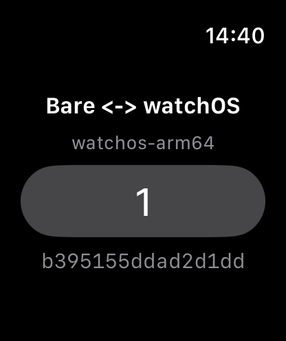

# Results

Measured on 2026-11-07 on one Mac. Nothing here ran on a real Apple Watch.

- Mac17,2 (Apple M5), macOS 26.7.1 (25G241).
- Xcode 26.2 (17C52): watchOS and watchOS Simulator SDKs 26.2, simulator runtime watchOS 26.2 (23S303), simulator
  `Apple Watch Series 11 (46mm)`. Linker: Xcode's ld-1230.1.
- `../tools`: bare-make 2.1.2, cmake-toolchains 2.2.2 with the fork over it, cmake-runtime 4.3.1, ninja-runtime
  1.13.2, llvm-runtime 23.1.6-0 (clang 23.1.5). Node 24.21.0, npm 11.19.0, XcodeGen 2.46.0.
- Sources: Bare v1.36.2 (c0b6b3b, what bare-kit 3.0.1 fetches) and libuv v1.53.0 (840404ce, what Bare fetches), each
  with its fork's commit; bare-kit 174ecf8 (3.0.1) and bare-kit-swift 7be67fc (2.2.0), each with its fork's commit;
  libqjsng 8f10631, which builds QuickJS-NG 0.18.0 with its 11 patches; libjs b03f452; libintrusive 01eae7f.

## Clean run

With `../work`, every `node_modules`, `build`, `prebuilds`, `BareKit.xcframework` and this repository's generated files
removed:

```sh
../build.sh            # tools sources barekit example addons: exit 0, 6 min 15 s
../build.sh app run    # exit 0, 47 s
```

Logs: `../logs/clean-build.log`, `../logs/clean-app-run.log`. 170 compiler and linker warnings, none an error: 114
`variable 'err' set but not used` and 36 others from Bare, libuv and the addons (unused variables, a typedef
redefinition in uv.h), 18 `-undefined dynamic_lookup is deprecated on watchOS` (one per addon link, cmake-bare links
every Apple addon that way), and two that are real on arm64_32 only, both harmless here: Bare's `runtime.c` puts a
64-bit `st_size` in a 32-bit `size_t` (a file of 4 GiB or more would read short), and sodium-native's `pbkdf2.c` has a
range check that is always false with a 32-bit `size_t`.

## BareKit.xcframework

`../forks/bare-kit-swift/BareKit.xcframework`, built by `../build.sh barekit` from bare-kit-swift's own CMake with
`BARE_ENGINE=github:holepunchto/libqjsng#8f1063161a1d66ea870d1590bf460b7916f21da8`, one `bare-make generate`, `build`
and `install` per target as `holepunchto/actions/compile-prebuilds` does, then merged as
`holepunchto/actions/create-xcframework` does with its fork's grouping.

| Library identifier        | Architectures                                | `BareKit`   | `minos` (LC_BUILD_VERSION) |
| ------------------------- | -------------------------------------------- | ----------- | -------------------------- |
| `watchos-arm64_arm64_32`  | arm64_32 (3,059,928 B) + arm64 (3,080,592 B) | 6,160,784 B | 8.0, 26.0                  |
| `watchos-arm64-simulator` | arm64                                        | 3,088,136 B | 8.0                        |

- Both frameworks' `Info.plist` say `MinimumOSVersion` 8.0. The toolchains target watchOS 8.0 for every arch, as Xcode
  uses one deployment target for both device archs; Xcode's linker raises the arm64 slice to 26.0 by itself (checked
  with a plain Xcode watch app at 10.0: arm64_32 `minos 10.0`, arm64 `minos 26.0`).
- They load only CoreFoundation, libSystem and libobjc, and export Bare Kit, `js_*`, `napi_*` and `uv_*`. The engine
  strings in the binary are `quickjs-ng` and `0.18.0`.

## The app

`../build.sh app`: `xcodegen generate`, then `BARE_KIT_LOCAL=1 xcodebuild -scheme App` for
`platform=watchOS Simulator,name=Apple Watch Series 11 (46mm)` and for `generic/platform=watchOS` with
`CODE_SIGNING_ALLOWED=NO`. Both `** BUILD SUCCEEDED **`. The pre-actions ran `bare-link --preset watchos`, which made
`bare-inspect.3.1.10`, `bare-type.1.4.0` and `sodium-native.5.2.0` xcframeworks (the addons the worklet's module graph
loads), and `bare-pack --preset watchos --linked`, which made `app.bundle` (183,021 B).

| Debug build       | App       | Architectures    | BareKit     | sodium-native | bare-inspect | bare-type |
| ----------------- | --------- | ---------------- | ----------- | ------------- | ------------ | --------- |
| watchOS Simulator | 4,596 KiB | arm64            | 3,088,432 B | 798,912 B     | 68,832 B     | 68,944 B  |
| watchOS, unsigned | 9,152 KiB | arm64_32 + arm64 | 6,160,784 B | 1,654,832 B   | 200,624 B    | 200,864 B |

The device build is compiled and linked only: not signed, not installed, not run.

## In the simulator

`../build.sh run` installs the simulator build, launches it with `simctl launch --console-pty`, takes
[`media/simulator.png`](media/simulator.png) after 5 s and shuts the simulator down:



- `watchos-arm64` is `Bare.platform` and `Bare.arch` as the worklet reports them.
- `1` is the worklet's count after the app's first write: the app wrote to `Bare.IPC` and the worklet answered.
- `b395155ddad2d1dd` starts the BLAKE2b-256 of `Hello from Bare` that sodium-native's `crypto_generichash` computed in
  the worklet, loaded from `sodium-native.5.2.0.framework` (linked with `-undefined dynamic_lookup`, its 41 `js_*` and
  `napi_*` imports resolved from BareKit at run time). Node with the same sodium-native 5.2.0 on the Mac gives
  `b395155ddad2d1dd3d0a21f1aedc3e830c7b47e98a0433f67da0ce74e30ddb16`.
- The console (`build/console.log`) has only the launch line; no crash report was written.

## Tests of the forks

| Fork               | Run                               | Result                                                                                                    |
| ------------------ | --------------------------------- | --------------------------------------------------------------------------------------------------------- |
| cmake-toolchains   | `brittle-node test.js`            | 455/455, of which 42 build for the three watchOS toolchains                                               |
| bare-addon-resolve | `npm test` (Bare and Node)        | 96/96 each, with a new `linked module, watchos`                                                           |
| bare-link          | `npm test` (Bare and Node)        | 58/58 each, with four new watchOS tests; the dependent addon one fails without the `references.js` change |
| bare-pack          | `brittle-bare` and `brittle-node` | 25/25 each                                                                                                |

Not run: cmake-toolchains under Bare, and the suites of Bare, bare-kit and bare-kit-swift, which build for the host.

## What went wrong on the way

- **c-ares caches `IOS` as true on watchOS** (its `CHECK_C_SOURCE_COMPILES` on `TARGET_OS_IPHONE`), so bare-kit's
  `if(IOS)` compiled `ios/suspension.m` for watchOS: 14 errors, `'UIApplication' is unavailable: not available on
watchOS`. bare-kit and bare-kit-swift now test `CMAKE_SYSTEM_NAME` instead. On watchOS bare-kit takes the
  `suspension.c` path, as on macOS: no background task is held while a suspended worklet lingers.
- **Bare main with bare-kit 3.0.1 aborts at boot**: `Cannot load addon 'builtin:bare-url@2.5.5'`, as Bare main
  registers bare-url 2.5.6 and bare-kit's worklet bundle asks for 2.5.5. Not a watchOS problem; the build uses Bare
  1.36.2, as bare-kit pins it.
- **XcodeGen gives a watchOS app only `@executable_path` as its runpath**, so dyld didn't find the addon frameworks
  (`Library not loaded: @rpath/bare-inspect.3.1.10.framework/...`). `project.yml` adds `@executable_path/Frameworks`.
- **holepunchto/actions' `create-xcframework`** grouped `watchos-arm64_32` apart from `watchos-arm64`; its fork groups
  them.

## What only a real watch can prove

- arm64_32 execution: the simulator runs arm64 only, so QuickJS-NG, Bare and the addons have not run with 32-bit
  pointers anywhere.
- Memory: the simulator sets no limit, and its numbers are a Mac process's.
- Loading addon frameworks linked with `-undefined dynamic_lookup` on a device, and an install signed for one.
- Lifecycle: what watchOS does to a suspended worklet that holds no background task.
- Networking: a watch allows only URLSession's HTTP tasks (TN3135), so libuv's TCP and UDP can't reach anything there.
  This app opens no socket.
