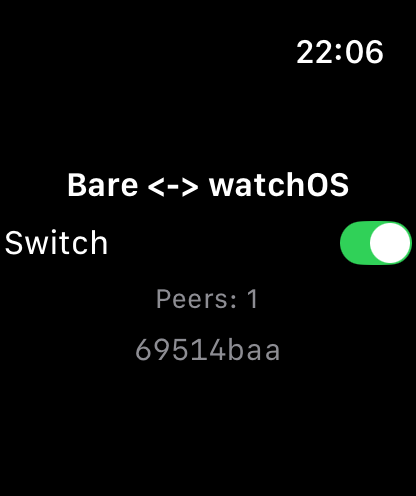
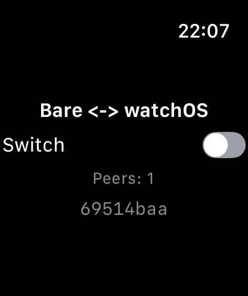

# Results

Measured on 2026-11-07 on one Mac. Nothing here ran on a real Apple Watch.

- Mac17,2 (Apple M5), macOS 26.7.1 (25G241).
- Xcode 26.2 (17C52): watchOS and watchOS Simulator SDKs 26.2, simulator runtime watchOS 26.2 (23S303), simulator
  `Apple Watch Series 11 (46mm)`. Linker: Xcode's ld-1230.1.
- Node 24.21.0, npm 11.19.0, XcodeGen 2.46.0. bare-make 2.1.2, cmake-toolchains 2.2.2 with its patch, cmake-runtime
  4.3.1, ninja-runtime 1.13.2, llvm-runtime 23.1.6-0 (clang 23.1.5), from `package.json`.
- The pins in `build.sh`, each with its `patches/`: Bare v1.36.2 and libuv v1.53.0, what bare-kit 3.0.1 and Bare
  fetch; bare-kit 174ecf8 (3.0.1) and bare-kit-swift 7be67fc (2.2.0); libjs b03f452 and libintrusive 01eae7f; libqjsng
  8f10631, which builds QuickJS-NG 0.18.0 with its 11 patches; and the commits the other patched repositories start
  from.
- The worklet: hyperswarm 4.17.2, hyperdht 6.36.0, `@hyperswarm/dht-relay` at 5036c4b with its patches,
  `@ciranda/dht-relay-http` at b9b1610, bare-switch-core 1.3.0 and bare-foundation 0.1.1 with their patches,
  sodium-native 5.2.0, udx-native 1.22.1, hrpc 4.3.1. The `overrides` in `package.json` give `@hyperswarm/dht-relay`
  sodium-universal 5 and noise-handshake 4.2, so the app links one sodium-native, 5.2.0, instead of 5.2.0 and 4.3.3.
- The app: bare-rpc-swift 1.1.0 and compact-encoding-swift 1.0.0, pinned in `project.yml` (see below).

## A clean clone

This repository at 80aaad0 and `dht-relay-http` at b9b1610, each cloned into a new temporary directory, side by side:

```sh
./build.sh    # sources deps barekit addons app: exit 0, 488 s
```

Log: `../logs/clone/build.log`. Every patch applied at its pin, and each patched tree is the same git tree as the branch
the patch came from (Bare and libuv: that branch rebased onto v1.36.2 and v1.53.0). 187 warnings, none an error: 114
`variable 'err' set but not used`, 33 unused variables and 6 typedef redefinitions from Bare, libuv and the addons, 30
`-undefined dynamic_lookup is deprecated` (cmake-bare links every Apple addon that way), 2 from Xcode's App Intents
step, and two that are real on arm64_32 only, both harmless here: Bare's `runtime.c` puts a 64-bit `st_size` in a
32-bit `size_t` (a file of 4 GiB or more would read short), and sodium-native's `pbkdf2.c` has a range check that is
always false with a 32-bit `size_t`. The clone had no changes to its tracked files afterwards.

## BareKit.xcframework

`vendor/bare-kit-swift/BareKit.xcframework`, built by `./build.sh barekit` from bare-kit-swift's own CMake with
`BARE_ENGINE=github:holepunchto/libqjsng#8f1063161a1d66ea870d1590bf460b7916f21da8`, one `bare-make generate`, `build`
and `install` per target as `holepunchto/actions/compile-prebuilds` does, then merged as
`holepunchto/actions/create-xcframework` does with its patch.

| Library identifier        | Architectures                                | `BareKit`   | `minos` (LC_BUILD_VERSION) |
| ------------------------- | -------------------------------------------- | ----------- | -------------------------- |
| `watchos-arm64_arm64_32`  | arm64_32 (3,059,928 B) + arm64 (3,080,592 B) | 6,160,784 B | 8.0, 26.0                  |
| `watchos-arm64-simulator` | arm64                                        | 3,088,136 B | 8.0                        |

- Both frameworks' `Info.plist` say `MinimumOSVersion` 8.0. The toolchains target watchOS 8.0 for every arch, as Xcode
  uses one deployment target for both device archs; Xcode's linker raises the arm64 slice to 26.0 by itself (checked
  with a plain Xcode watch app at 10.0: arm64_32 `minos 10.0`, arm64 `minos 26.0`).
- They load only CoreFoundation, libSystem and libobjc, and export Bare Kit, `js_*`, `napi_*` and `uv_*`. The engine
  strings in the binary are `quickjs-ng` and `0.18.0`.

## The app

`./build.sh app`: `xcodegen generate`, then `BARE_KIT_LOCAL=1 xcodebuild -scheme App` for
`platform=watchOS Simulator,name=Apple Watch Series 11 (46mm)` and for `generic/platform=watchOS` with
`CODE_SIGNING_ALLOWED=NO`. Both `** BUILD SUCCEEDED **`. `app.bundle` is 1,477,550 B: 275 files, 203 of them
JavaScript, and five linked addons, made into xcframeworks by the scheme's `bare-link --preset watchos`.

| Debug build       | App        | BareKit     | bare-foundation | sodium-native | udx-native | bare-inspect | bare-type |
| ----------------- | ---------- | ----------- | --------------- | ------------- | ---------- | ------------ | --------- |
| watchOS Simulator | 6,756 KiB  | 3,088,432 B | 93,072 B        | 798,912 B     | 242,064 B  | 68,832 B     | 68,944 B  |
| watchOS, unsigned | 12,220 KiB | 6,160,784 B | 208,160 B       | 1,654,832 B   | 535,392 B  | 200,624 B    | 200,864 B |

The simulator build is arm64, the device build arm64_32 + arm64. bare-foundation links Foundation, CoreFoundation,
libSystem and libobjc, `minos` 8.0. The device build is compiled and linked only: not signed, not installed, not run.

## The switch in the simulator

The app of the clean clone, built Debug with `RELAY_URL` `http://localhost:49443`, and the relay and the peer on the
Mac, on the public DHT, from the two clones:

```sh
node ../dht-relay-http/bin.js --port 49443 --host 127.0.0.1
node peer.js
```

A script that is not part of this repository booted the simulator, started both, waited 15 s for the peer's announce,
launched the app with `simctl launch --console-pty`, read the worklet's lines from the unified log (`log stream`),
pressed enter in `peer.js` five times and then tapped the switch five times with an XCUITest runner, 3 s apart. Then it
stopped the relay, started it again 10 s after the worklet had lost it, and flipped once from each side. Logs:
`../logs/clone/switch-run.log`, `switch-summary.json`, the app's unified log (`switch-watch-raw.log`) and the runner's
(`switch-xctest.log`).

| Connected, off                    | Flipped on in `peer.js` | Flipped off on the watch | Joined again after the relay came back |
| --------------------------------- | ----------------------- | ------------------------ | -------------------------------------- |
|  |      |     |     |

| Launch to `up` | `up` to the first peer | `peer.js` to the watch (ms) | The watch to `peer.js` (ms) | Relay back to a peer |
| -------------- | ---------------------- | --------------------------- | --------------------------- | -------------------- |
| 399 ms         | 1,854 ms               | 6.5, 7.2, 7.0, 4.4, 6.2     | 5.8, 3.5, 4.0, 4.6, 5.4     | 6,850 ms             |

- Launch to `up` is from `simctl launch` to the worklet's `[worklet] up` line, which it writes once its bundle is
  evaluated and the swarm made. The app's first line in the unified log came 157 ms before `up`.
- A flip is timed from the line of the side that flipped (`peer.js`'s `set` on its stdout, the worklet's `set` in the
  unified log) to the line of the other side (`state`), all on the Mac's clock. The relay and the peer are on the same
  Mac as the simulator, so this is the relay's path, not a network's. Two earlier runs, built from the same changes
  before they were patches and without the rejoin, measured 2.9 to 8.7 ms one way and 3.3 to 14.5 ms the other.
- Every flip arrived, each value once. The relay logged `Session opened (1)` as the worklet started.
- When the relay stopped, its held poll answered `410`, the worklet logged it and `peers - 0`, and tried again every 5
  s (`Could not connect to the server.`, twice). The relay logged `Session opened (1)` 5.0 s after it was back, and
  the worklet had its peer 1.8 s later; then a flip from each side arrived (7.0 ms and 5.1 ms).
- Memory, as `footprint` reports the app's process: 37 MB once connected, 44 MB after the flips, 45 MB at the end. This
  is a Mac process: the whole app, SwiftUI and Bare Kit with the worklet's QuickJS-NG heap, and the simulator sets it
  no limit.

The worklet used only URLSession:

- `app.bundle` has no bare-tcp, bare-net, bare-dns, bare-pipe or ws. It has udx-native, as hyperswarm requires hyperdht,
  whose dht-rpc requires udx-native when it loads, so its framework is linked and loaded. The worklet makes no UDX
  socket: each swarm is given the relayed DHT and never makes one of its own.
- `lsof -p` on the app's process, once connected, after the flips and at the end, listed directories, files, character
  devices, kqueues and pipes, and no socket of any kind.
- CFNetwork logged 93 data tasks of the app with a response: 91 `200`, the `410` above, and a `404` for the session the
  stopped relay no longer had. It also logged 71 failed tasks: the two that couldn't connect while the relay was down,
  and 69 numbered apart from the app's, each right after an `Uploading ATS exception ATSAllowsLocalNetworking`, its own
  report of the ATS exception.

## Tests of the patches

| Repository           | Run                               | Result                                                               |
| -------------------- | --------------------------------- | -------------------------------------------------------------------- |
| bare-foundation      | `npm test` (Bare, darwin-arm64)   | 8/8, 48/48 asserts, with a new `exiting with a data task in flight`  |
| bare-switch-core     | `npm test` (Bare), `npm run lint` | 11/11, 27/27 asserts, with a new `joins as a client only when asked` |
| hyperswarm-dht-relay | `npm test` (standard, Node)       | 18/18, 56/56 asserts, 3 upstream skips, with five new tests          |
| cmake-toolchains     | `brittle-node test.js`            | 455/455, of which 42 build for the three watchOS toolchains          |
| bare-addon-resolve   | `npm test` (Bare and Node)        | 96/96 each, with a new `linked module, watchos`                      |
| bare-link            | `npm test` (Bare and Node)        | 58/58 each, with four new watchOS tests                              |
| bare-pack            | `brittle-bare` and `brittle-node` | 25/25 each                                                           |

The last four were run on the first version of this example and not again. The new tests of bare-foundation and
hyperswarm-dht-relay fail without their fixes: `exiting with a data task in flight` with the child Bare ended by
`SIGSEGV`, `client mode, keep-alive of the server` for `custodial: false`, and `stream that fails to open` with an
unhandled rejection.

## What went wrong on the way

- **Bare crashed on exit with a data task in flight.** The task's threadsafe function outlived the environment: Bare's
  last turn of the loop delivered the completion and libjs entered a disposed isolate (`SIGSEGV` in
  `js_threadsafe_function_s::call()` from `bare_runtime_teardown`). Each task now registers a deferred teardown, as
  bare-dns does for its lookups: the teardown cancels the task, and its completion lets the environment go without
  calling into JavaScript.
- **The keep-alives of the peer flipped the switch off.** A client of `@hyperswarm/dht-relay` without custody gets the
  peer's keep-alives, every 5 s from hyperdht, as empty messages, and bare-switch-core reads an empty message as off.
  hyperdht's own streams filter them; the patch sets `filterZeroByteMessages` on the client's `SecretStream`.
- **An unreachable relay was an uncaught error.** In Node, the worklet's code with no relay ended on `fetch failed`
  from the relay's stream, which nothing listened to, and then on an unhandled rejection of the protocol's opening,
  which nothing awaits. Bare aborts on either. `app.js` handles the errors of its stream and joins again 5 s after it
  closes, and the patch leaves no unhandled rejection.
- **The spec's Swift packages didn't build.** They asked for bare-rpc-swift and compact-encoding-swift at `main`,
  where bare-rpc-swift 2.0.0 no longer has the `RPCDelegate` the generated `HRPC` uses. Regenerated with hrpc-swift and
  hyperschema-swift 1.0 they ask for `from: "1.0.0"`, but they still say macOS 11 and iOS 14, which SwiftPM reads as
  watchOS 7, while bare-rpc-swift 1.1.1 and compact-encoding-swift 1.0.1 say macOS 13 and iOS 15, so watchOS 8:
  `The package product 'BareRPC' requires minimum platform version 8.0 for the watchOS platform, but this target
supports 7.0`. `project.yml` pins the last releases before that.
- **Two sodium-natives.** `@hyperswarm/dht-relay` asks for sodium-universal 4 and noise-handshake 3, which bring
  sodium-native 4.3.3 next to 5.2.0. noise-handshake 4.0.0 only added a length check to 3.1.0, and dht-relay uses
  sodium for `crypto_generichash` and `crypto_sign` alone, so `overrides` give it the versions hyperdht uses.
- **Bare's watchOS patch doesn't apply to v1.36.2 as it is on main**: `src/bare.d.ts` differs there, so the patch in
  `patches/bare` adds the same two values to v1.36.2's lists. Bare main can't be used: bare-kit 3.0.1's worklet asks
  for `builtin:bare-url@2.5.5` and Bare main registers 2.5.6.
- **A client finds only the peers that announced before it looked.** Hyperswarm looks a topic up when it joins and
  then every 10 minutes. The worklet's code under the Bare CLI on the Mac, started 3 s after `peer.js`, connected in
  one run and had no peer 12 s later in another; started 15 s after, it connected.
- **XCUITest's tap on the switch didn't flip it.** The element spans the whole row and the tap lands in its middle;
  tapping its knob does.
- **One launch hung on the watch's launch screen**, after an XCUITest session on the same booted simulator: no line
  from the worklet, and the process answered neither `footprint`, `sample` nor `simctl terminate`. It didn't happen
  again on a freshly booted simulator. The cause wasn't found.

## What only a real watch can prove

- The network: a watch allows only URLSession's HTTP tasks (TN3135), and it needs the relay over HTTPS. The simulator
  allows sockets, so the runs above show that the worklet opened none, not that a watch lets URLSession reach the
  relay, nor how a watch's radios, Wi-Fi or the paired phone carry the long polls.
- arm64_32 execution: the simulator runs arm64 only, so QuickJS-NG, Bare and the addons have not run with 32-bit
  pointers anywhere.
- Memory: the simulator sets no limit, and its numbers are a Mac process's.
- Loading addon frameworks linked with `-undefined dynamic_lookup` on a device, and an install signed for one.
- Lifecycle: what watchOS does to a suspended worklet that holds no background task, and to its long poll; the relay
  closes a session after 60 s without a request.
